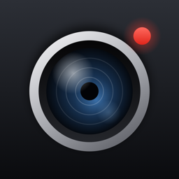

# Spyglass

An iPhone app for watching the cameras on your [Frigate NVR](https://frigate.video) server.

Spyglass is an independent project and is not affiliated with Frigate.

## Features

- **Camera grid** with live snapshots of every camera. A red dot marks cameras that record continuously.
- **Live view** for each camera.
- **Recordings timeline** for continuously recording cameras:
  - Drag to scrub through footage, with momentum.
  - Pinch or use the + and − buttons to zoom.
  - Gaps in the recordings are shown in gray.
  - Skip back and forward 10 seconds, pause live, or jump to any date and time.
  - Mute and unmute audio.
- **Events** list and detail, shown only when your server has object detection turned on.
- **Camera order** you can rearrange in Settings.
- **Light, dark or automatic** appearance.

## Requirements

- iOS 17 or later. On iOS 26, the tab bar shrinks while you scroll.
- Xcode 26 or later to build.
- A Frigate server (tested with Frigate 0.18).

## Getting started

1. Open `FrigateViewer.xcodeproj` in Xcode.
2. Choose your development team under **Signing & Capabilities**, and change the bundle identifier (`com.admiralduder.Spyglass`) to one of your own.
3. Build and run on a simulator or your iPhone.
4. In the app, open **Settings** and enter your server address, for example `http://192.168.1.10:5000`, then tap **Save & Connect**.

### Connecting to Frigate

- **Port 5000** is Frigate's unauthenticated port. It needs no username or password.
- **Port 8971** is the authenticated port. Enter your Frigate username and password. Turn on **Allow self-signed certificate** if your server uses Frigate's default certificate.

Your password is stored in the iOS Keychain. Server settings never leave your device except to talk to your Frigate server.

## License

[MIT](LICENSE)
